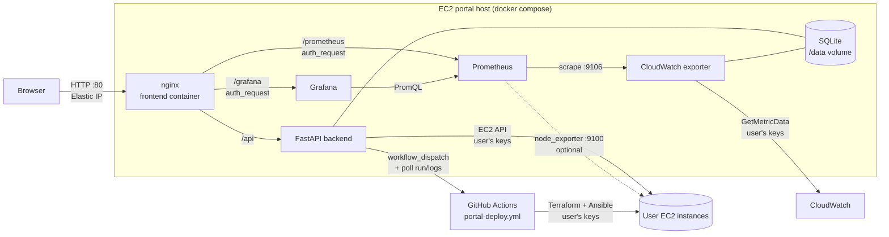
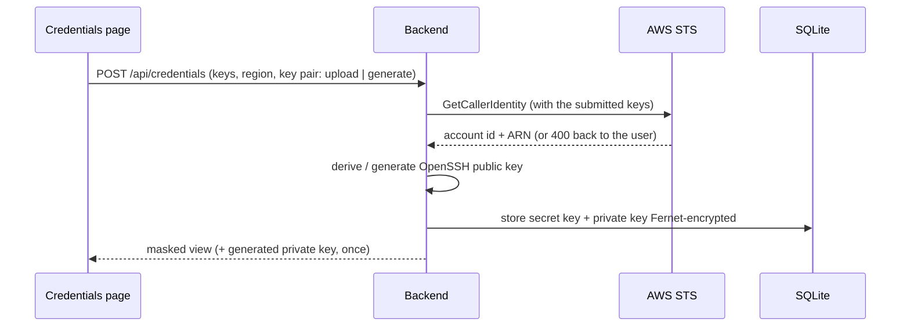
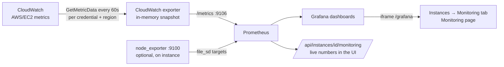
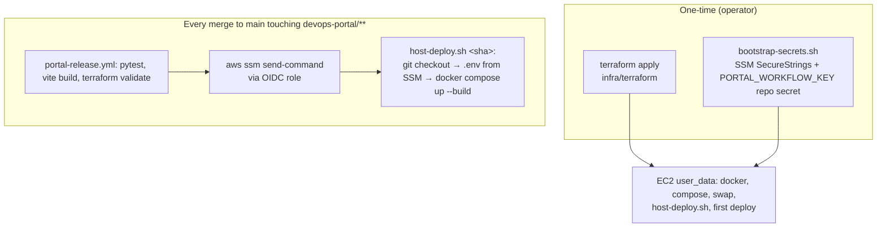

# DevOps Portal — Architecture

How the portal works end to end: what runs where, how a request moves
through the system, where secrets live, and how the portal itself is
deployed. For step-by-step operating instructions see
[demo-runbook.md](demo-runbook.md).

---

## 1. What the portal does

A user signs in, uploads their AWS access key + secret and an SSH key pair,
fills in a form, and the portal:

1. **Provisions** EC2 instances with Terraform (run on GitHub Actions).
2. **Configures** them with Ansible (packages, Docker image, k3s, custom commands).
3. **Manages** them afterwards: pause (stop), resume (start), restart
   (reboot), terminate, and day-2 Ansible runs.
4. **Monitors** them: CloudWatch metrics → Prometheus → Grafana, embedded in
   the portal UI.

Each user only sees their own credentials, deployments and instances, and
every AWS call is made with **that user's** keys.

---

## 2. Component map



| Component | Code | Role |
|---|---|---|
| **Frontend** | `devops-portal/frontend` | React SPA (Vite + Tailwind), served by nginx. nginx is also the reverse proxy and the login gate for Grafana/Prometheus (`nginx.conf`). |
| **Backend** | `devops-portal/backend` | FastAPI. Auth, credentials, deployments, instance actions, reconcile loop. |
| **CloudWatch exporter** | `backend/exporters/cloudwatch_exporter.py` | Separate process (same image). Reads the portal DB, pulls CloudWatch metrics per account/region, serves them on `:9106`. |
| **Prometheus** | `monitoring/prometheus/prometheus.yml` | Scrapes the exporter (all instances) and node_exporter (instances that installed it). |
| **Grafana** | `monitoring/grafana/` | Provisioned datasource + two dashboards: *Fleet Overview* and *Instance Overview*. Embedded in the UI. |
| **Deploy workflow** | `.github/workflows/portal-deploy.yml` | Runs Terraform + Ansible for one deployment. |
| **Release workflow** | `.github/workflows/portal-release.yml` | Tests the portal and redeploys the host over SSM. |
| **Host infra** | `devops-portal/infra/terraform` | EC2 host, Elastic IP, IAM, SSM parameters. |

---

## 3. Backend layout

```
backend/
├── main.py                     FastAPI app, routers, background reconcile loop
├── database/db.py              SQLite schema + queries (users, aws_credentials,
│                               deployments, instances, instance_configurations)
├── models/schemas.py           DeploymentRequest and response models
├── routes/
│   ├── auth.py                 register / login / logout / me / verify
│   ├── credentials.py          AWS keys + SSH key pairs
│   ├── deploy.py               plan / deploy / SSE log stream / status
│   ├── instances.py            list, start/stop/reboot/terminate, configure, monitoring
│   ├── history.py              deployment history
│   └── overview.py             dashboard counts
├── services/
│   ├── auth.py                 scrypt hashing, JWT cookie, get_current_user
│   ├── crypto.py               Fernet encryption (at rest + workflow bundle)
│   ├── aws_clients.py          boto3 session per credential, STS check, SSH keys
│   ├── ssh_keys.py             writes a private key to disk only for one job
│   ├── deployment_execution.py picks local vs github_actions runner
│   ├── local_executor.py       Terraform + Ansible pipeline
│   ├── github_actions_executor.py  dispatch, follow run, sync instances
│   ├── aws_reconciler.py       EC2 state sync, tag discovery, post-action polling
│   ├── instance_configurator.py    day-2 Ansible
│   ├── prometheus_targets.py   node_exporter file_sd targets
│   └── metrics_query.py        Prometheus queries for the UI's live numbers
├── generators/                 terraform_gen.py (HCL), ansible_gen.py (playbooks)
├── exporters/cloudwatch_exporter.py
├── scripts/                    run_portal_deployment.py, open_workflow_bundle.py
└── tests/test_portal_api.py
```

---

## 4. Request flows

### 4.1 Sign-in

1. `POST /api/auth/register` or `/login` with email + password.
2. Passwords are hashed with **scrypt** (per-user salt, `services/auth.py`).
3. The backend returns a **HS256 JWT** in an `HttpOnly`, `SameSite=Lax`
   cookie (`portal_session`, 12 h). JavaScript never sees the token.
4. Every API route depends on `get_current_user`, so a missing/expired cookie
   returns 401 and the SPA shows the login screen.
5. nginx calls `GET /api/auth/verify` (`auth_request`) before proxying
   `/grafana/` and `/prometheus/`, so those UIs are login-protected too.

The first account to register adopts any rows that existed before auth was
added. Sign-up can be limited with `PORTAL_ALLOW_SIGNUP=false|first`.

### 4.2 Adding credentials



- The **secret access key** and **SSH private key** are encrypted with
  `PORTAL_ENCRYPTION_KEY` before they touch the DB, and are never returned by
  the API. A *generated* private key is returned once so the user can
  download it.
- Only the **public key** is needed to launch instances: each deployment
  registers it in the target region via a Terraform `aws_key_pair`, so one
  key pair works in every region with no manual EC2-console step.

### 4.3 Deploying

```mermaid
sequenceDiagram
    participant UI as Deploy page
    participant BE as Backend
    participant GH as GitHub Actions
    participant AWS as AWS (user's account)
    UI->>BE: POST /api/deploy {credential_id, region, type, packages...}
    BE->>BE: fill key pair from the credential, create deployment row
    BE->>BE: seal {AWS keys, SSH key pair} with PORTAL_WORKFLOW_KEY
    BE->>GH: workflow_dispatch portal-deploy.yml (inputs + credentials_blob)
    BE-->>UI: deployment_id; UI opens SSE /api/deploy/{id}/stream
    GH->>GH: open_workflow_bundle.py: decrypt, ::add-mask::, export env
    GH->>AWS: terraform apply (SG, key pair, EC2 - tagged PortalDeploymentId)
    GH->>AWS: ansible-playbook over SSH
    loop every 5s
        BE->>GH: run status + job steps  ->  [GITHUB] lines on the SSE stream
    end
    BE->>GH: download run logs (after completion)
    BE->>AWS: DescribeInstances tag:PortalDeploymentId=<id>
    BE->>BE: save instances, rewrite Prometheus targets
```

- The run is found by its **run-name** `portal-<deployment_id> <mode>`
  because `workflow_dispatch` does not return a run id.
- The GitHub runner's disk is throwaway, so the backend discovers the new
  instances itself by **EC2 tag** after the run succeeds.
- The run uploads `main.tf`, `setup.yml`, `inventory.ini` and
  `terraform.tfstate` as an artifact (30 days) so a deployment's SG/key pair
  can be destroyed with Terraform later if needed.
- `DEPLOYMENT_RUNNER_MODE=local` runs the same pipeline
  (`local_executor.py`) inside the backend container instead. The user's
  keys go to Terraform via environment variables and the private key is
  written to a 0600 temp file for the job only.

### 4.4 Managing instances (day 2)

| UI action | Endpoint | EC2 call | Notes |
|---|---|---|---|
| Pause | `POST /instances/{id}/stop` | `StopInstances` | state → `stopping` → `stopped` |
| Resume | `POST /instances/{id}/start` | `StartInstances` | new public IP recorded |
| Restart | `POST /instances/{id}/reboot` | `RebootInstances` | |
| Terminate | `DELETE /instances/{id}` | `TerminateInstances` | |
| Configure | `POST /instances/{id}/configure` | — | Ansible over SSH with the stored key, SSE logs |

Power actions return immediately with a transitional state; a background
task (`wait_for_stable_state`) polls EC2 until the instance settles and
records the new IPs. The UI polls every 5 s while anything is transitioning.

A **reconcile loop** (`RECONCILE_INTERVAL_SECONDS`, default 120 s) also
re-reads every instance from EC2, so changes made in the AWS console show up
in the portal and in monitoring.

### 4.5 Monitoring pipeline



**Why a custom exporter instead of `prom/cloudwatch-exporter`?** The stock
exporter uses one AWS credential chain and a static config per process.
Portal users each bring their own keys and instances come and go, so the
portal's exporter reads the instance list + owning credential from the DB
and batches `GetMetricData` per (credential, region). It keeps the official
exporter's naming, so standard queries work:

| Metric | Source |
|---|---|
| `aws_ec2_cpuutilization_average` / `_maximum` | CPUUtilization |
| `aws_ec2_network_in_sum`, `aws_ec2_network_out_sum`, `..._packets_..._sum` | NetworkIn/Out, packets |
| `aws_ec2_ebsread_bytes_sum`, `aws_ec2_ebswrite_bytes_sum`, `..._ops_sum` | EBS (Nitro types) |
| `aws_ec2_status_check_failed_maximum` (+ `_instance`, `_system`) | Status checks |
| `aws_ec2_cpucredit_balance_average`, `aws_ec2_cpucredit_usage_sum` | Burstable types |
| `aws_ec2_instance_info{state}` / `aws_ec2_instance_running` | Portal DB (1 per instance) |
| `cloudwatch_requests_total`, `cloudwatch_exporter_errors_total`, `cloudwatch_exporter_last_refresh_timestamp_seconds` | Exporter health |

Labels: `instance_id, name, region, instance_type, deployment_id, owner,
account_id`. node_exporter targets carry the same `instance_id`/`owner`
labels so dashboards join both sources.

- **CloudWatch** covers every instance with no agent and no inbound port.
  Detailed monitoring (1-minute) is on by default
  (`detailed_monitoring` in the form, about $2/instance/month); with it off,
  data arrives every 5 minutes.
- **node_exporter** (tick *Node Exporter* in the form or on the Configure
  tab) adds memory, disk and load. Port 9100 is opened only to the portal
  host's security group, and Prometheus scrapes the **private** IP
  (`PROMETHEUS_SCRAPE_ADDRESS=private`). That works for instances in the
  portal's region/VPC; other regions rely on CloudWatch.
- **Grafana** runs with anonymous *Viewer* access, reachable only through
  nginx's login gate, and is embedded same-origin under `/grafana`. The fleet
  dashboard is filtered by the hidden `owner` variable, which the portal
  sets to the user's id.

---

## 5. Security model

| Concern | How it is handled |
|---|---|
| Transport | **Plain HTTP** on the host's Elastic IP. The security group admits port 80 only from `http_ingress_cidrs` (default `0.0.0.0/0`; narrow it); there is no SSH (SSM Session Manager only). Without TLS, passwords and uploaded AWS keys cross the network unencrypted, so cookies are not `Secure`. |
| Passwords | scrypt, per-user salt; uniform error for unknown email / bad password. |
| Sessions | HS256 JWT in an HttpOnly, SameSite=Lax cookie (also blocks cross-site POST). |
| AWS keys & SSH private keys at rest | Fernet (`PORTAL_ENCRYPTION_KEY`), never returned by the API. |
| Keys in transit to GitHub | Sealed with a **separate** key (`PORTAL_WORKFLOW_KEY`), shared only with the repo secret. The workflow masks every value before it can reach a log. |
| Keys on disk | Private keys are written 0600 for one job and deleted (`ssh_keys.py`; runner removes `~/.ssh/*.pem` in an `always()` step). |
| Tenant isolation | Every query is filtered by `user_id`; instance actions load the credential that created the instance. Tested in `tests/test_portal_api.py`. |
| Portal host permissions | The instance role can only read `/devops-portal/*` parameters. It has **no** EC2/CloudWatch rights; all AWS work uses the users' keys. |
| Release pipeline | GitHub → AWS via OIDC (no stored keys). The role can only `ssm:SendCommand` on the portal host, from the `portal-production` environment. |
| Secrets for the host | SSM Parameter Store SecureStrings, rendered into a root-only `.env` at deploy time; never in Terraform state or git. |

**Known limitations**

- The repository is **public**, so GitHub Actions logs for deployments are
  publicly readable. Secrets are encrypted and masked, but instance IPs,
  regions and custom commands are visible. Make the repo private for real use.
- Grafana's `owner` filter is a convenience, not an access-control boundary:
  any logged-in user who edits the dashboard URL can view other users'
  CloudWatch series (but not their credentials or actions).
- Plan-mode and failed runs leave no AWS resources; a deployment whose
  instances are terminated from the portal leaves its security group and key
  pair behind (tagged `PortalDeploymentId`). Use the run artifact's
  `terraform.tfstate` to destroy them.
- SQLite + one host means a single point of failure; back up the
  `backend_data` volume (it holds the DB *and* any auto-generated keys).

---

## 6. Naming and tagging

Everything is named so it can be told apart in the AWS console at a glance.

| Owner | Resource | Name / tags |
|---|---|---|
| Portal host stack (Terraform) | EC2, SG, EIP, IAM roles, profile | `devops-portal-host`, `devops-portal-host-sg`, `-eip`, `-role`, `-profile`, `-github-release`; tags `Project=devops-portal`, `Component=portal-host`, `ManagedBy=terraform` |
| Portal host config | SSM parameters | `/devops-portal/<name>` (`encryption_key`, `jwt_secret`, `workflow_key`, `github_token`, `grafana_admin_password`, `runner_mode`, `allow_signup`, `public_host`, `monitoring_sg_id`, `monitoring_sg_region`, `github_repo`) |
| User deployments | Security group | `devops-portal-<deployment8>-sg-<random>` |
| | Key pair | `devops-portal-<deployment8>-<key name>-<random>` |
| | Instances | `<form name>-<n>`, or `devops-portal-<deployment8>-<n>` |
| | Tags on all of the above | `Project=devops-portal`, `Component=workload`, `ManagedBy=DevOpsAutomationPortal`, `PortalDeploymentId=<uuid>`, `monitoring=enabled\|cloudwatch` |
| GitHub | Deploy runs | `portal-<deployment uuid> plan\|deploy`, artifact `portal-<deployment uuid>` |

---

## 7. Hosting and release



`host-deploy.sh` is idempotent and is the only way code reaches the host:
first boot runs it from user_data, and every release runs it over SSM.
Because the repo is public, the host clones anonymously; the GitHub token in
SSM is used only by the backend to dispatch `portal-deploy.yml`.

`DEPLOYMENT_RUNNER_MODE` comes from `/devops-portal/runner_mode`.
`github_actions` requires `portal-deploy.yml` to exist on the repository's
**default branch** (a GitHub rule for `workflow_dispatch`); until it is
merged, `local` runs the identical pipeline inside the backend container.

---

## 8. Configuration reference

All settings are environment variables; `backend/.env.example` documents
each one. On the host they are generated from SSM by `host-deploy.sh`.

| Variable | Default | Purpose |
|---|---|---|
| `PORTAL_ENCRYPTION_KEY` | auto (dev) | Fernet key for secrets at rest |
| `PORTAL_JWT_SECRET` | auto (dev) | Session signing |
| `PORTAL_WORKFLOW_KEY` | — | Fernet key shared with GitHub Actions |
| `DEPLOYMENT_RUNNER_MODE` | `local` | `local` or `github_actions` |
| `GITHUB_REPO` / `GITHUB_TOKEN` / `GITHUB_REF_NAME` | — / — / `main` | Workflow dispatch target |
| `PORTAL_ALLOW_SIGNUP` | `true` | `true`, `false`, `first` |
| `PORTAL_COOKIE_SECURE` | `false` | `true` behind HTTPS |
| `RECONCILE_INTERVAL_SECONDS` | `120` | EC2 sync loop (0 = off) |
| `CLOUDWATCH_REFRESH_SECONDS` | `60` | Exporter refresh interval |
| `PROMETHEUS_SCRAPE_ADDRESS` | `public` | `private` on the AWS host |
| `PORTAL_MONITORING_SG_ID` / `_REGION` | — | SG allowed to scrape node_exporter |
| `GRAFANA_PUBLIC_URL` | `/grafana` | Base for dashboard links |

---

## 9. Testing

- `backend/tests/test_portal_api.py`: auth flow, credential encryption and
  masking, PEM upload → public key, deploy request rewriting, cross-user
  isolation, Terraform naming/tags, workflow bundle round-trip, exporter
  metric names. Run with `python -m pytest -q` in `devops-portal/backend`.
- `portal-release.yml` runs the tests, a production frontend build and
  `terraform validate` on every PR touching the portal.
